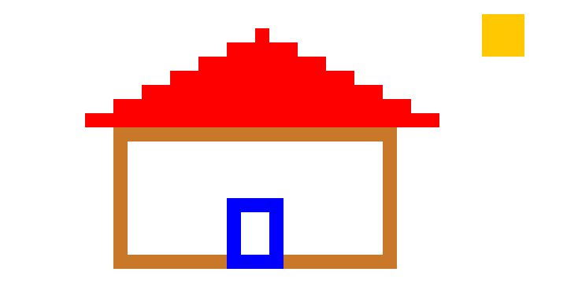
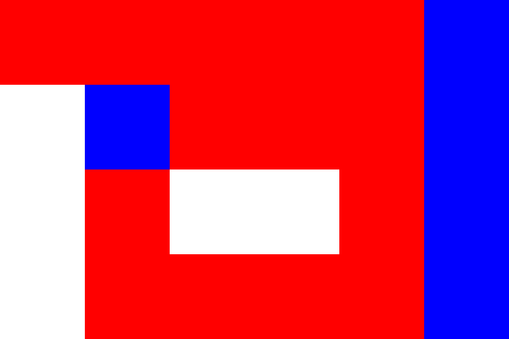

# Validação final com GCC

Data: 02/11/2026. Esta validação substitui as pendências de compilação e imagem
registradas na revisão anterior. A versão atual mantém somente o assistente
local por regras e o fluxo obrigatório Python → C → executável → PPM.

## Resultado

**81 testes aprovados, sem falhas e sem testes pulados**, com
`TINYDRAW_TESTE_GUI=1`. Incluem os testes completos de C, pixels, sobreposição,
autoteste e janela real do Studio. A suíte anterior à alteração também passou:
78 testes sem falhas nem testes pulados. Os três testes adicionais verificam
as correções descritas abaixo.

Foram usados Windows, Python 3.12.14 do ambiente de trabalho e GCC 16.2.0
(MSYS2 UCRT64, em `C:/msys64/ucrt64/bin`). Como a sessão de ferramentas ainda
não herdava o PATH novo, essa pasta foi adicionada apenas ao ambiente dos
processos de validação. Não foi feita mudança global de configuração.

## Correções pontuais

1. **UTF-8 com BOM:** o lexer ignora esse marcador somente no começo da fonte.
   Editores e PowerShell no Windows podem incluí-lo. O primeiro comando continua
   na coluna 1; BOM no meio do programa permanece um erro léxico.
2. **Saída relativa no pipeline:** o diretório de saída é resolvido para caminho
   absoluto antes de gravar e executar. Isso evita resolver o executável relativo
   novamente a partir da pasta escolhida como cwd. O teste compila e executa
   usando pasta e nome de programa com espaços.

Não foram acrescentados comandos à DSL nem serviços externos. O restante do
compilador e o runtime C foram preservados.

## Execução real dos exemplos

| Fonte | Resultado |
|---|---|
| casa.td | C compilado/executado, PPM e PNG de 40×20 pixels originais |
| moldura.td | C compilado/executado, PPM e PNG de 30×15 |
| sobreposicao.td | C compilado/executado, PPM e PNG de 24×12 |
| estudo.td | C compilado/executado, PPM e PNG de 6×4; todos os 24 pixels conferidos |

Os testes de geração também compilam os exemplos com `-Wall -Wextra -Werror`.
A CLI foi executada separadamente com `casa.td --executar`; o conversor de
arquivo criou PNG de 480×240 com fator 12. O autoteste informou OK em todas
as etapas: léxico, sintaxe, semântica, geração, compilação, execução e imagem.

As imagens em `evidencias/` vieram da execução real do C, não de um simulador.
O PNG de estudo foi também inspecionado visualmente.





## Evidências reproduzíveis

- `testes_com_gcc.txt`: saída completa dos 81 testes, com GUI ativada.
- `evidencias_execucao.txt`: resultados dos quatro exemplos e autoteste.
- `cli_final.txt`: saída da execução real pela CLI.
- `evidencias/*.ppm` e `evidencias/*.png`: imagens produzidas.
- `GUIA_DE_ESTUDOS.md`: exemplo completo atualizado com pixels conferidos.

Com Python instalado e GCC no PATH, na raiz do projeto:

```powershell
gcc --version
py --version
$env:TINYDRAW_TESTE_GUI = '1'
py -m unittest discover -v
Remove-Item Env:TINYDRAW_TESTE_GUI
py -m tinydraw exemplos/validos/casa.td --executar
py ferramentas/ppm_para_png.py build/casa.ppm 12
py tinydraw_studio.py
```

## O que ainda depende do computador ou da equipe

- O launcher `py` respondeu "No installed Python found" nesta sessão.
  Os testes foram executados pelo interpretador Python disponível no ambiente
  de trabalho; isso não comprova que `py` já funcionará no terminal do usuário.
  Se a mensagem também ocorrer no computador da apresentação, instale Python
  com Tcl/Tk ou selecione um interpretador instalado e repita os comandos.
- PyInstaller não está instalado neste ambiente. O pacote
  `dist/TinyDrawStudio.exe` não foi construído nem certificado. Ele é opcional
  para demonstrar a DSL; o executável C dos desenhos foi efetivamente validado.
- Os scripts `.bat` dependem de um Python acessível por `py`; o caminho de
  sucesso desses scripts não foi validado nesta sessão.
- Memorial, declaração real de ferramentas usadas e ensaio individual continuam
  pendentes da equipe. Não foram inventadas responsabilidades ou verificações
  pessoais. Todos devem conseguir explicar tokens, AST, semântica, C e pixels.

O resultado evidencia o núcleo implementado e testado, mas não certifica todos
os computadores de destino ou uma versão empacotada ainda não construída.
